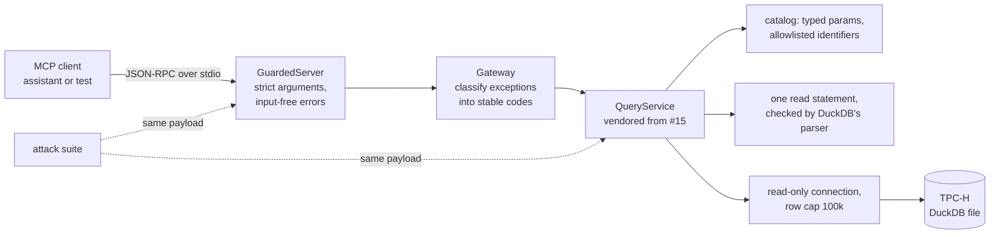

# MCP server over guarded warehouse queries

> A Model Context Protocol server that gives an AI assistant read-only, allowlisted access to a
> TPC-H sales warehouse, and a differential attack suite that proves the query guards still hold
> when the caller is a model speaking JSON-RPC instead of a person calling a Python API.

[](https://github.com/Prithv122/mcp-server/actions/workflows/ci.yml)

**Live demo:** not deployed — runs locally over stdio inside any MCP client
**Stack:** Python 3.13 · `mcp` 2.x SDK · DuckDB 1.5.5 · pandas · uv · pytest

---

## 1. The problem

Analysts want to ask an assistant questions of the warehouse. The obvious way to allow that, a
"run this SQL" tool, hands a language model (and anything that can inject text into its context)
a database connection. [`query-service`](https://github.com/Prithv122/query-service) already
solved this for a human client with four guard layers: bound values, allowlisted identifiers, a
single-read-statement check by DuckDB's own parser, and a read-only connection with a row cap. This
project exposes that service over MCP and asks whether the guards **survive the new boundary**:
the same payload sent through the protocol must get the same verdict as a direct call, with zero
writes, zero over-cap results, and error text that never repeats what the caller sent.

## 2. The data

| | |
|---|---|
| Source | TPC-H, generated locally by DuckDB's `tpch` extension (`CALL dbgen(sf=0.1)`) |
| Size | scale factor 0.1: 8 tables, 600,572 line items, 150,000 orders, 15,000 customers |
| Licence | generated data; no download, no licence attached |
| Test fixture | `mcpquery.minitpch`: the same 8 tables and column names with a few dozen deterministic rows, built offline, used by the tests and CI |

## 3. Architecture



| Surface | Name | What it does |
|---|---|---|
| tool | `list_queries` | names and descriptions of the 4 reviewed catalog queries |
| tool | `describe_query(name)` | parameter names, types, defaults and allowed values |
| tool | `run_query(name, params, limit)` | runs a catalog query; returns `{columns, rows, row_count, truncated, cached, elapsed_ms, limit}` |
| tool | `run_sql(sql, limit)` | one read statement; **only registered with `--allow-adhoc`** |
| resource | `warehouse://schema` | tables and columns from `information_schema` on the read-only connection |
| resource | `catalog://queries` | the whole catalog with parameter specs |
| prompt | `revenue_report(region, year)` | a report request; both arguments allowlisted |

Every rejection is `is_error: true` with a JSON body `{"code", "message"}`, `code` one of
`UNSAFE_QUERY`, `UNKNOWN_QUERY`, `BAD_PARAM`, `QUERY_FAILED`, `INTERNAL`.

## 4. Key decisions & tradeoffs

| Decision | Chose | Over | Why |
|---|---|---|---|
| Reuse the guards | vendored copy of #15 pinned by commit (`9363ae5`) | a git dependency, or rewriting the guards | the suite tests the guards as shipped; 900 auditable lines, no network at install |
| Unknown arguments | rejected (`BAD_PARAM`) | the SDK default of dropping them silently | a misplaced `region` would otherwise return an unfiltered, plausible, wrong number |
| Error text | templates filled from server-side facts only | passing the guard's message through | a model reads error text as instructions; the upstream messages quote the bad value and the SQL line |
| Ad-hoc SQL | off by default, `--allow-adhoc` to register `run_sql` | always on | the catalog answers the common questions; a model should not get a SQL prompt unasked |
| Transport | stdio only | also Streamable HTTP | HTTP means authentication and hosting; a local assistant launches the server as a subprocess |
| DuckDB | pinned to 1.5.5 (#15's lock) | latest 2.x | the parser-based read check is engine behaviour; test it on the engine it shipped on |
| Success criterion | pre-registered in [`EVAL_PLAN.md`](EVAL_PLAN.md) before the suite was written | judging the suite after seeing it | the payloads cannot be chosen to fit the result |
| File access | connection opened with external access disabled and its configuration locked (fixed upstream in #15) | trusting "read-only" | read-only stops writes, not `SELECT * FROM read_text('...')`; the suite's first run proved it |
| `limit` type | strict integer at the protocol layer | the SDK's lax coercion | lax mode turned `"5"` into 5 and `true` into 1 before the server's own check ran |
| Runaway queries | interrupt at the limit, then abandon and replace the connection; at most two abandoned | waiting for the interrupt | some DuckDB work never checks for an interrupt; a caller must get an answer anyway |

## 5. Results

All numbers below come from files in [`results/`](results/) and can be regenerated with the commands
in §6. The warehouse is TPC-H scale factor 0.1 generated locally; the mini fixture is synthetic.

### 5.1 Attack suite: the first run failed, and that was the useful part

The pass rule was committed in [`EVAL_PLAN.md`](EVAL_PLAN.md) before the suite existed: 0 bypasses
(no write, no result over the row cap, no payload the server accepts that the bare service rejects,
no `expect: reject` payload accepted, and, added in Amendment 2, no result over the 4 MB size
budget), 0 errors that repeat caller input, and a stable code on every **tool-call** rejection.

| Run | Payloads | Bypasses | Echoes | Coded tool rejections | Verdict |
|---|---:|---:|---:|---:|---|
| First run, mini fixture ([reproduction](results/attacks/first_run_mini.md)) | 94 | **5** (×2 transports) | 0 | 126/126 | **FAIL** |
| Amendment 2 first run, both warehouses | 111 | 0 | 0 | 164/164 | **FAIL**: a runaway query outlived the client timeout |
| Amendment 2 second run, TPC-H | 111 | 0 | 0 | – | **FAIL**: the benign size control timed out on a loaded machine |
| **Final, mini fixture** ([report](results/attacks/mini.md)) | 111 | **0** | **0** | **165/165** | **PASS** |
| **Final, TPC-H sf 0.1** ([report](results/attacks/tpch_sf0.1.md)) | 111 | **0** | **0** | **165/165** | **PASS** |

Every run uses both transports (in-process and a stdio subprocess). The final runs are at
`df38f15`; the middle two rows are recorded in [`EVAL_PLAN.md`](EVAL_PLAN.md) Amendment 2, because
their report files were overwritten by the reruns. The first-run report is a reproduction on a clean
clone with the pre-fix server files; the original in-session output was not saved.

What the first run found, and what fixed it:

| Payloads | Found | Where the hole was | Fix |
|---|---|---|---|
| `fs-01`..`fs-03` | `SELECT * FROM read_text('C:/Windows/win.ini')`, `read_csv(...)` and `glob('*')` through `run_sql` returned rows: **any file the process could read was readable** | the vendored #15 guards: a table function is one `SELECT`, so the parser check passes it, and a read-only connection only blocks writes | upstream in #15 (`9363ae5`): `enable_external_access = false`, `lock_configuration = true`; re-vendored |
| `lm-04`, `lm-05` | `limit: "5"` ran as 5 rows, `limit: true` as 1 | the SDK's lax validation coerced them before the server's own check | strict integer type on `limit` |

Two more problems surfaced outside the suite and were fixed before the rerun: the tool-selection eval
(§5.3) showed that `params: {"limit": 5}` collided with `QueryService.run(limit=...)` and crashed as
`INTERNAL` (a `use_cache` key would have reached the cache switch the same way), and testing the
document-search resource showed that the SDK repeats an unknown resource URI in its error. The 8
payloads added after the first run are marked `[A1]` and listed in the plan's Amendment 1.

An independent review from a clean context then tried about 110 payloads by hand. It found no write,
file read or row-cap bypass, and every number above matched `results/`, but it found what the suite
had not tried, now covered by 9 `[A2]` payloads:

| Found by the review | Fix |
|---|---|
| no time limit: `SELECT count(*) FROM range(10^11)` held the connection, and every other call waited | a per-query limit (10 s by default, 2 s in the suite) that interrupts DuckDB |
| the interrupt is not always honoured: building one 200M-element LIST noticed it after 148 s (this failed the next run) | a query still running 1 s past the limit is abandoned: the caller gets the timeout error, a fresh connection serves the next call, and with two abandoned queries running new calls are refused |
| the row cap does not bound bytes: 100,000 rows of 2 KB came back as 202 MB | rows are rendered within a 4 MB budget, `truncated_by: "size"` |
| LIST values lost elements through numpy's `str()`; BLOBs printed as `bytearray(...)` | rendered as JSON arrays and hex |
| the runner counted client exceptions as rejections and could not fail an `ok` without row data | both now fail the run; the echo check also tests SQL fragments and prompt names |

In the final runs, MCP and the bare service agree on 175 of 189 comparable results (92.6%). All 14
disagreements (7 payloads × 2 transports) are the server being stricter on purpose, each tagged with
its reason in the suite: string, boolean and fractional limits (`lm-04`..`lm-06`), arguments outside
the tool's schema (`ua-01`, `ua-03`), a `params` key naming the service's own `use_cache` switch
(`ps-02`), and an empty date window (`ex-08`). The echo check excludes words the server itself
publishes (tool, parameter and query names); without that exclusion it counts 106 hits, all names
like `end_date` or `run_sql`. One payload, a lone UTF-16 surrogate (`ex-07`), cannot be sent over
stdio at all (the client's JSON encoder refuses it), so it is judged in-process only.

### 5.2 Latency: what the protocol costs

p50 in ms over 30 timed calls after a warm-up, TPC-H sf 0.1 ([full table](results/latency_sf0.1.md)).
**Not a quiet machine:** five other projects were being built at the same time, so compare within a
row, not with other runs. Measured at `25bca0f`, before the per-query time limit existed; the worker
thread and timer it adds to every query, cached or not, are not in these numbers.

| Call | Rows returned | Bare service, cached | MCP in-process, cached | MCP over stdio, cached | MCP over stdio, cold |
|---|---:|---:|---:|---:|---:|
| `run_query: late_shipments` | 5 | 5.4 | 8.7 | 11.8 | 49.4 |
| `run_query: revenue_by_dimension` | 25 | 5.3 | 9.2 | 11.8 | 64.8 |
| `run_query: daily_order_volume` | 365 | 5.1 | 17.4 | 22.0 | 30.6 |
| `run_query: top_customers` | 1,000 | 6.5 | 57.2 | 56.4 | 165.1 |
| `list_queries` | – | 0.0 | 1.8 | 5.3 | – |

The overhead is not the protocol hop, it is the rows. On a cache hit, the MCP layer adds about 3 ms to
a 5-row answer and about 51 ms to a 1,000-row, 6-column one, almost all of it turning a DataFrame into
JSON twice (structured content plus a text copy). The stdio pipe adds 0-5 ms per call. Starting a
stdio server (spawn to a ready client) took 7-10 s here, so a client should keep one process alive,
which is what desktop clients do.

### 5.3 Tool selection with a local model (secondary, not gated)

`qwen2.5:7b-instruct` (Q4, Ollama, temperature 0) got the tool list, the server instructions and the
catalog, and one of 20 analyst questions frozen before the first call ([results](results/tool_eval_qwen7b.md),
[tasks](eval/tool_tasks.jsonl)). Correct means the right query and every pinned parameter equal to the
reference.

**11/20 correct (Wilson 95% interval 0.34 to 0.74).** It never picked the wrong query. Of the 9
misses:

- **7 are the same mistake: an inclusive end date** (`1995-12-31` for "1995" instead of `1996-01-01`),
  although the tool description says `end_date` is exclusive and one task says "both days included".
  **The server accepted all 7 and returned a plausible answer missing the last day.** No guard can
  catch that: the call is valid.
- 1 added a filter the query does not have (rejected with `BAD_PARAM`).
- 1 put `limit` inside `params`, which exposed the crash described in §5.1.

The run replays offline from the recorded responses; [after the fixes](results/tool_eval_qwen7b_replay_after_fix.md)
the score is the same and the crash is a coded `BAD_PARAM`. With n = 20 the interval is wide, so this
says nothing about other models, only that a 7B model reads a half-open date window the way people do.

### 5.4 What this does and does not show

- It shows that, for these 111 payloads, the server's verdicts are at least as strict as the bare
  service's on both transports and on both warehouses, that nothing was written, and that no error
  repeated caller input. It does not prove that no other payload gets through: the first run found a
  class of hole (table functions) that the original #15 tests had not tried, and the review found
  another (resource exhaustion) that the suite had not tried.
- **Known limits, not fixed here:**
  - The time limit bounds how long the *caller* waits, not the work. An abandoned query keeps using
    CPU and memory until it ends, and the limit covers the query, not turning its rows into JSON.
    A hard bound needs the query in a separate process or limits in the database itself.
  - DECIMAL and HUGEINT values arrive as float64 (the vendored service converts results through
    pandas): exact to about 15 significant digits. TPC-H's largest sum here has 14.
  - With `--allow-adhoc`, `SELECT * FROM duckdb_databases()` shows the warehouse file's absolute
    path. Metadata functions are not blocked.
  - Prompt calls the SDK rejects before the prompt function runs (missing or mistyped arguments)
    come back as an uncoded `Internal server error`: 4 of the suite's 12 prompt rejections.
  - `SELECT 1; -- comment` is rejected (`QUERY_FAILED`): the upstream limit wrapper strips only a
    final semicolon. It fails closed.
- The most damaging failure in this project is not an attack. It is a valid call with an off-by-one
  date that returns a wrong number with no error. §7 says what I would change.

## 6. How to run

Prerequisites: [uv](https://docs.astral.sh/uv/) and Python 3.13 (uv installs it). Ollama only for
the optional tool-selection eval.

```bash
git clone https://github.com/Prithv122/mcp-server.git
cd mcp-server
uv sync
uv run pytest                      # offline: uses the mini fixture
uv run mcpquery attack-suite       # the differential suite on the mini fixture, both transports
```

The real warehouse and the measurements:

```bash
uv run mcpquery build-db --sf 0.1                                     # TPC-H, ~20 s; fetches DuckDB's tpch extension once
uv run mcpquery attack-suite --db data/warehouse.duckdb --out results/attacks/tpch_sf0.1.json
uv run mcpquery latency --db data/warehouse.duckdb --out results/latency_sf0.1.json
uv run mcpquery tool-eval --db data/warehouse.duckdb --replay         # re-scores the recorded model responses, no model needed
```

Use it from an MCP client: copy [`.mcp.json.example`](.mcp.json.example), set the repository path,
and the client starts `mcpquery serve` over stdio. Add `--allow-adhoc` to the arguments to expose
`run_sql`.

## 7. What I'd change at 100× scale

- **Make the date window impossible to misread.** The biggest measured error is a valid call with a
  wrong answer. Replace `start_date`/`end_date` with a `period` argument (`1995`, `1995-Q3`,
  `1995-03`) the server expands, or return the resolved window in every result (`"window":
  "1995-01-01 <= o_orderdate < 1995-12-31"`) so the mistake is visible in the answer.
- **Stream or page large results.** Serialisation is the cost (51 ms for 1,000 rows here). At 100x
  the rows, return a page plus a cursor, send rows once instead of twice, and for analytics clients
  offer Arrow instead of JSON.
- **Move layer 4 to the database.** A read-only DuckDB file on one machine becomes a warehouse role
  with `SELECT` grants on named views only, no file or network functions, and a statement timeout.
  The protocol layer keeps its checks; the database stops trusting them.
- **One server per user, not per process.** stdio means one server process per client. Shared use
  needs the Streamable HTTP transport, authentication, per-user row limits and an audit log of every
  tool call, which is where the error-code contract pays off.
- **Bound the work, not just the wait.** Run each ad-hoc query in a worker process with a memory cap
  that can be killed, or push the limits into the database (statement timeout, memory limit per
  role). The thread-and-abandon design here keeps the caller responsive but cannot reclaim an
  abandoned query's CPU and memory.
- **Run the attack suite against every engine upgrade.** Layer 3 depends on DuckDB's parser and its
  statement types; a new DuckDB version could add a statement or table function the suite has not
  seen. The suite runs in CI on every push, so a dependency bump runs it too.

---

## References

- Model Context Protocol specification and the official Python SDK (`mcp`, MIT).
- TPC-H benchmark specification (schema), via DuckDB's `tpch` extension.
- [`query-service`](https://github.com/Prithv122/query-service) (#15), the guarded service this
  server exposes.
