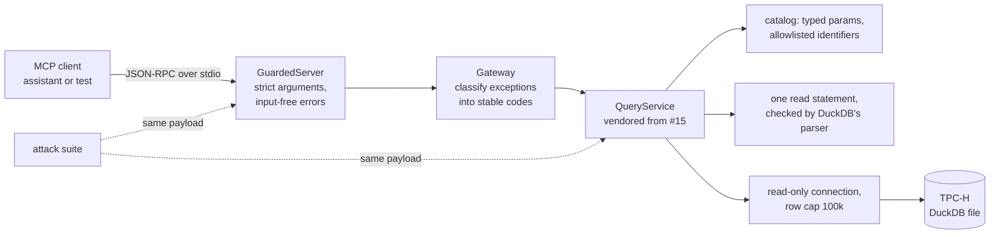

# MCP server over guarded warehouse queries

> A Model Context Protocol server that gives an AI assistant read-only, allowlisted access to a
> TPC-H sales warehouse, and a differential attack suite that proves the query guards still hold
> when the caller is a model speaking JSON-RPC instead of a person calling a Python API.

**Live demo:** not deployed — runs locally over stdio inside any MCP client
**Stack:** Python 3.13 · `mcp` 2.x SDK · DuckDB 1.5.5 · pandas · uv · pytest

---

## 1. The problem

Analysts want to ask an assistant questions of the warehouse. The obvious way to allow that, a
"run this SQL" tool, hands a language model (and anything that can inject text into its context)
a database connection. [`query-service`](https://github.com/Prithv122/query-service) already
solved this for a human client with four guard layers: bound values, allowlisted identifiers, a
single-read-statement check by DuckDB's own parser, and a read-only connection with a row cap. This
project exposes that service over MCP and asks whether the guards **survive the new boundary**:
the same payload sent through the protocol must get the same verdict as a direct call, with zero
writes, zero over-cap results, and error text that never repeats what the caller sent.

## 2. The data

| | |
|---|---|
| Source | TPC-H, generated locally by DuckDB's `tpch` extension (`CALL dbgen(sf=0.1)`) |
| Size | scale factor 0.1: 8 tables, 600,572 line items, 150,000 orders, 15,000 customers |
| Licence | generated data; no download, no licence attached |
| Test fixture | `mcpquery.minitpch`: the same 8 tables and column names with a few dozen deterministic rows, built offline, used by the tests and CI |

## 3. Architecture

| Surface | Name | What it does |
|---|---|---|
| tool | `list_queries` | names and descriptions of the 4 reviewed catalog queries |
| tool | `describe_query(name)` | parameter names, types, defaults and allowed values |
| tool | `run_query(name, params, limit)` | runs a catalog query; returns `{columns, rows, row_count, truncated, cached, elapsed_ms, limit}` |
| tool | `run_sql(sql, limit)` | one read statement; **only registered with `--allow-adhoc`** |
| resource | `warehouse://schema` | tables and columns from `information_schema` on the read-only connection |
| resource | `catalog://queries` | the whole catalog with parameter specs |
| prompt | `revenue_report(region, year)` | a report request; both arguments allowlisted |

Every rejection is `is_error: true` with a JSON body `{"code", "message"}`, `code` one of
`UNSAFE_QUERY`, `UNKNOWN_QUERY`, `BAD_PARAM`, `QUERY_FAILED`, `INTERNAL`.

## 4. Key decisions & tradeoffs

| Decision | Chose | Over | Why |
|---|---|---|---|
| Reuse the guards | vendored copy of #15 pinned by commit (`9363ae5`) | a git dependency, or rewriting the guards | the suite tests the guards as shipped; 900 auditable lines, no network at install |
| Unknown arguments | rejected (`BAD_PARAM`) | the SDK default of dropping them silently | a misplaced `region` would otherwise return an unfiltered, plausible, wrong number |
| Error text | templates filled from server-side facts only | passing the guard's message through | a model reads error text as instructions; the upstream messages quote the bad value and the SQL line |
| Ad-hoc SQL | off by default, `--allow-adhoc` to register `run_sql` | always on | the catalog answers the common questions; a model should not get a SQL prompt unasked |
| Transport | stdio only | also Streamable HTTP | HTTP means authentication and hosting; a local assistant launches the server as a subprocess |
| DuckDB | pinned to 1.5.5 (#15's lock) | latest 2.x | the parser-based read check is engine behaviour; test it on the engine it shipped on |
| Success criterion | pre-registered in [`EVAL_PLAN.md`](EVAL_PLAN.md) before the suite was written | judging the suite after seeing it | the payloads cannot be chosen to fit the result |

## 5. Results

_Pending: the attack suite, latency and tool-selection runs on the real warehouse._

## 6. How to run

_Pending._

## 7. What I'd change at 100× scale

_Pending._

---

## References

- Model Context Protocol specification and the official Python SDK (`mcp`, MIT).
- TPC-H benchmark specification (schema), via DuckDB's `tpch` extension.
- [`query-service`](https://github.com/Prithv122/query-service) (#15), the guarded service this
  server exposes.
